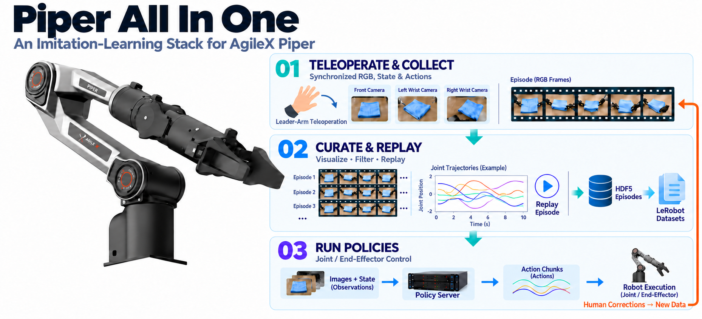

<p align="center">
  <h1 align="center">Piper All In One</h1>
</p>

<p align="center">
  
</p>

Piper All In One is an imitation-learning stack for [AgileX Piper](https://global.agilex.ai/products/piper) robotic arms and [Cobot Magic](https://global.agilex.ai/products/cobot-magic) systems. It covers the full robot-learning loop: hardware bring-up, teleoperated data collection, data replay, LeRobot dataset conversion, and policy inference.

> ‼️ Safety first: this repository controls real robot arms. Keep the emergency stop reachable, start from a clear workspace, verify CAN/camera mappings before motion, and test every new policy with slow, supervised motions before normal operation.

## 📰 News

- **Oct 25 2026**: Update to v1.1, added support for async ensemble inference and human-guided DAgger.
- **Apr 29 2026**: Repository released.

## 📋 Contents

- [📰 News](#-news)
- [📋 Contents](#-contents)
- [🗂️ Repository Layout](#️-repository-layout)
- [⚙️ Setup](#️-setup)
  - [Prerequisites](#prerequisites)
    - [Hardware](#hardware)
    - [Software](#software)
  - [Installation](#installation)
    - [Clone the Repository](#clone-the-repository)
    - [Install System Packages](#install-system-packages)
    - [Configure CAN Interfaces](#configure-can-interfaces)
    - [Create Python Environments](#create-python-environments)
    - [Build the Camera Workspace](#build-the-camera-workspace)
    - [Build the Piper Workspace](#build-the-piper-workspace)
- [🚀 Usage](#-usage)
  - [Start Cameras](#start-cameras)
  - [Start Arms](#start-arms)
  - [Collect Data](#collect-data)
  - [Visualize Data](#visualize-data)
  - [Replay Data](#replay-data)
  - [Convert Data to LeRobot](#convert-data-to-lerobot)
  - [Run Policy Inference](#run-policy-inference)
    - [Synchronous Inference](#synchronous-inference)
    - [Asynchronous Inference](#asynchronous-inference)
    - [Asynchronous Ensemble Inference](#asynchronous-ensemble-inference)
    - [Human-guided DAgger Inference](#human-guided-dagger-inference)
- [🧩 Configuration Reference](#-configuration-reference)
  - [Task Configs](#task-configs)
  - [Policy Clients](#policy-clients)
- [📊 Dataset Format](#-dataset-format)
- [🙏 Acknowledgements](#-acknowledgements)

## 🗂️ Repository Layout

```text
.
├── camera_ws/                         # ROS workspace for RealSense cameras
├── piper_ws/                          # ROS workspace for Piper messages and launch files
├── collect_data/                      # Data collection, replay, and visualization scripts
├── convert_data/                      # HDF5 filtering and LeRobot conversion scripts
├── inference/                         # Policy clients and sync/async inference runners
├── lerobot/                           # LeRobot submodule used for dataset conversion
```

## ⚙️ Setup

### Prerequisites

#### Hardware

- **Four AgileX Piper or PiperX arms**: two leader arms for teleoperation, and two follower arms for execution.
- **Two USB-to-CAN modules**: one for each leader-follower pair in the standard 2CAN workflow.
- **Four USB-to-CAN modules for DAgger**: one per leader and follower arm when using human takeover.
- **Three RealSense cameras**: one front camera and two wrist cameras, with each wrist camera mounted on a follower arm.
- **A control machine** with enough USB bandwidth for all cameras and CAN devices.

#### Software

- **Ubuntu 20.04**: recommended because this release targets ROS Noetic.
- **ROS Noetic**: follow the [installation guide](https://wiki.ros.org/noetic/Installation/Ubuntu) and install `ros-noetic-desktop-full`.
- **Conda**: used to manage Python environments.
- **Terminator**: recommended when running multiple ROS terminals.

### Installation

#### Clone the Repository

```bash
git clone --recurse-submodules https://github.com/innovator-zero/piper-aio.git
cd piper-aio
```

If you already cloned without submodules, initialize them with:

```bash
git submodule update --init --recursive
```

#### Install System Packages

```bash
sudo apt update
sudo apt install -y \
  libgflags-dev \
  libgoogle-glog-dev \
  libusb-1.0-0-dev \
  libeigen3-dev \
  libkdl-parser-dev \
  can-utils \
  ethtool \
  net-tools

sudo apt install -y \
  ros-$ROS_DISTRO-image-geometry \
  ros-$ROS_DISTRO-camera-info-manager \
  ros-$ROS_DISTRO-image-transport \
  ros-$ROS_DISTRO-image-publisher \
  ros-$ROS_DISTRO-libuvc-ros \
  ros-$ROS_DISTRO-ddynamic-reconfigure
```

#### Configure CAN Interfaces

Connect the CAN modules, then list their USB bus information:

```bash
bash piper_ws/scripts/find_all_can_port.sh
```

For the standard 2CAN setting, edit [`piper_ws/scripts/can_config.sh`](piper_ws/scripts/can_config.sh):

- Set `EXPECTED_CAN_COUNT` to the number of connected CAN modules.
- Update the `USB_PORTS` mapping so each `bus-info` value maps to the intended CAN interface name and bitrate.
- The default two-module mapping uses `can_left:1000000` and `can_right:1000000`.

For the 4CAN DAgger setting, edit [`piper_ws/scripts/can_config_dagger.sh`](piper_ws/scripts/can_config_dagger.sh) instead. DAgger uses four interface names: `can_left_fol`, `can_right_fol`, `can_left_lea`, and `can_right_lea`.

After each machine startup, run the matching CAN activation script once to rename and bring up the CAN interfaces.

For the standard 2CAN setting:

```bash
bash piper_ws/scripts/can_config.sh
```

For the 4CAN DAgger setting:

```bash
bash piper_ws/scripts/can_config_dagger.sh
```

#### Create Python Environments

Create the main environment used by ROS control, collection, replay, and inference:

```bash
conda create -y -n piperaio python=3.10
conda activate piperaio

pip install python-can piper_sdk
pip install empy==3.3.4 rospkg catkin_pkg numpy==1.26.4 h5py opencv-python matplotlib
conda install -y libffi==3.3
```

If you plan to convert collected data to the [LeRobot](https://github.com/huggingface/lerobot) dataset format, create a separate conda environment for LeRobot (dataset `v2.1`, commit `2b71789`):

```bash
conda create -y -n lerobot python=3.10
conda activate lerobot

conda install -y ffmpeg -c conda-forge

cd lerobot
pip install -e .
pip install datasets==3.6.0
cd ..
```

Note: Keep the `datasets` package version consistent between conversion and training. Version mismatches can make converted datasets unreadable.

#### Build the Camera Workspace

The camera workspace is based on [realsense-ros](https://github.com/realsenseai/realsense-ros/tree/ros1-legacy) and should be built from source. Install RealSense SDK 2.0 using the [official guide](https://github.com/realsenseai/librealsense/blob/master/doc/distribution_linux.md#installing-the-packages), then build the workspace:

```bash
sudo apt install -y ros-$ROS_DISTRO-realsense2-camera
exec $SHELL

conda activate piperaio

cd camera_ws/src
catkin_init_workspace
cd ..
catkin_make \
  -DPYTHON_EXECUTABLE=$HOME/miniconda3/envs/piperaio/bin/python \
  -DCATKIN_ENABLE_TESTING=False \
  -DCMAKE_BUILD_TYPE=Release
cd ..
```

Set `PYTHON_EXECUTABLE` to the Python executable in the `piperaio` conda environment if your conda path differs.

List connected camera serial numbers:

```bash
bash piper_ws/scripts/rs_camera_serial.sh
```

Add the serial numbers to lines 2-4 of [`camera_ws/src/realsense-ros/realsense2_camera/launch/multi_camera.launch`](camera_ws/src/realsense-ros/realsense2_camera/launch/multi_camera.launch) according to their physical positions.

#### Build the Piper Workspace

```bash
conda activate piperaio

cd piper_ws/src
catkin_init_workspace
cd ..
catkin_make -DPYTHON_EXECUTABLE=$HOME/miniconda3/envs/piperaio/bin/python
cd ..
```

Source the Piper workspace in your shell startup file:

```bash
# Bash
echo "source $(pwd)/piper_ws/devel/setup.bash" >> ~/.bashrc

# Zsh
echo "source $(pwd)/piper_ws/devel/setup.zsh" >> ~/.zshrc
```

## 🚀 Usage

Run each long-running command in a separate terminal, and make sure the `piperaio` environment is active where needed.

### Start Cameras

```bash
./start_cam.sh
```

Use `rqt_image_view` to inspect the streams from the three cameras.

### Start Arms

Use mode 0 for leader-follower teleoperation during data collection:

```bash
./start_mode0.sh
```

Use mode 1 when controlling the follower arms during replay or inference, and wait until both follower arms report `Enable Status: True`:

```bash
./start_mode1.sh
```

Use the 4CAN DAgger launch when running policy inference with human takeover:

```bash
bash piper_ws/scripts/can_config_dagger.sh
./start_dagger.sh
```

In this mode policy commands go to `/follower_cmd/joint_left` and `/follower_cmd/joint_right`; human actions from the leader arms are published on `/leader/joint_left` and `/leader/joint_right` and are forwarded to the follower command topics only while DAgger takeover is active.

### Collect Data

1. Power on all four arms.
2. Start cameras with `./start_cam.sh`.
3. Start arms in mode 0 with `./start_mode0.sh`.
4. Start the collection script:

```bash
conda activate piperaio

python collect_data/collect_data.py --dataset_dir ~/data --task_name test
```

To move one arm to zero at startup and fix it in place, use `--fix_zero`:

```bash
python collect_data/collect_data.py --dataset_dir ~/data --task_name test --fix_zero left
python collect_data/collect_data.py --dataset_dir ~/data --task_name test --fix_zero right
```

Any arm not selected by `--fix_zero` is restored to normal leader-follower mode before collection.

Keyboard controls:

- `ENTER`: start recording an episode.
- `SPACE`: stop the current recording.
- `s`: save the current episode.
- `q`: discard the current episode.
- `Ctrl+C`: exit the collection script.

Episodes are saved to `{dataset_dir}/{task_name}/episode_{episode_idx}.hdf5`.

When `--episode_idx` is omitted or set to `0`, the script automatically uses the next available episode index in the save directory.

Note: the system may occasionally drop frames and report `syn fail`, so avoid collecting data too quickly, especially during complex motions. Also check USB bandwidth and verify all camera and arm topics are publishing at the expected rate.

### Visualize Data

```bash
conda activate piperaio

python collect_data/visualize_episodes.py --dataset_dir ~/data --task_name test --episode_idx 0
```

The visualization script plays and saves camera videos, joint plots, and end-effector pose plots for the selected episode.

For an interactive Rerun web viewer over one episode or a directory of HDF5 episodes:

```bash
pip install rerun-sdk
python collect_data/visualize_episodes_rerun.py --dataset_path ~/data/test
```

Use `--collect_label` to show only frames whose `/collect` label exactly matches the selected value. For example, to inspect human takeover frames:

```bash
python collect_data/visualize_episodes_rerun.py \
  --dataset_path ~/data/test \
  --collect_label dagger
```

When `--collect_label` is omitted, the viewer shows all frames.

### Replay Data

1. Power on only the two follower arms.
2. Start cameras with `./start_cam.sh`.
3. Start arms in mode 1 with `./start_mode1.sh`.
4. Replay an episode:

```bash
conda activate piperaio

python collect_data/replay_data.py --dataset_dir ~/data --task_name test --episode_idx 0 --replay_mode joint
```

`replay_mode` can be either `joint` or `eef`. The script reads the recorded data and sends control commands to the control topics.

### Convert Data to LeRobot

First inspect collected episodes for outliers:

```bash
conda activate lerobot

python convert_data/dataset_filter.py --root_dir ~/data/test --std_threshold 5.0
```

`--root_dir` should point to `{dataset_dir}/{task_name}`. The script analyzes `observations/qpos` and `action`, then reports files with values outside the standard-deviation threshold configured by `--std_threshold`.

Before conversion, edit [`convert_data/convert_to_lerobot.py`](convert_data/convert_to_lerobot.py):

- Set `INSTRUCTION` to the language instruction used for training.
- Add any rejected HDF5 episode paths to `exclude_files`.

Convert one or more task directories to a LeRobot v2.1 dataset using the feature schema in [`convert_data/features.py`](convert_data/features.py):

```bash
conda activate lerobot

python convert_data/convert_to_lerobot.py \
  --src_path ~/data \
  --tgt_path ~/lerobot \
  --repo_ids test \
  --save_repoid test \
  --cut_head \
  --cut_tail
```

Useful options:

- `--src_path`: root directory containing collected task folders, which corresponds to `{dataset_dir}`.
- `--tgt_path`: output root for the converted LeRobot dataset.
- `--repo_ids`: one or more task names to convert, which correspond to `{task_name}`.
- `--save_repoid`: output dataset name. Defaults to the first `--repo_ids` value.
- `--cut_head` / `--no-cut_head`: trim or keep still frames at the start.
- `--cut_tail` / `--no-cut_tail`: trim or keep still frames at the end.
- `--zero_arm`: use `left` or `right` to overwrite that arm's 7 joint/action/eef dimensions with zeros.
- `--collect_label`: optionally convert only contiguous `/collect` spans with this exact label. For example, `--collect_label dagger` saves each DAgger span as a separate LeRobot episode.

### Run Policy Inference

Policy inference uses task settings from [`inference/task_configs.yaml`](inference/task_configs.yaml) and client code from [`inference/clients.py`](inference/clients.py). Refer to [Configuration Reference](#-configuration-reference) on how to add new tasks and clients.

We provide four inference runners:

- Synchronous inference in [`inference/infer_sync.py`](inference/infer_sync.py): standard practice for action-chunking policy. The robot executes one action chunk and requests the next chunk only after the current chunk has been consumed. During policy inference, the robot controller pauses and resumes only when the new actions arrive.
- Asynchronous inference in [`inference/infer_async.py`](inference/infer_async.py): initiates inference for the next chunk before the current chunk is fully executed. Once the next inference request is triggered, the robot continues executing the remaining actions in the ongoing chunk. Before the final action is completed, the newly predicted chunk is expected to be available, enabling seamless execution without halting. Useful for real-time methods such as [Training-time RTC](https://arxiv.org/abs/2512.05964) and [FASTER](https://github.com/innovator-zero/FASTER).
- Asynchronous ensemble inference in [`inference/infer_async_ensemble.py`](inference/infer_async_ensemble.py): requests action chunks asynchronously and linearly blends newly predicted actions with the remaining queued actions to smooth chunk transitions.
- Human-guided DAgger inference in [`inference/infer_hg_dagger.py`](inference/infer_hg_dagger.py): runs synchronous policy inference with an interactive mode for 4CAN human takeover and DAgger frame collection.

> Refer to our [FASTER](https://arxiv.org/abs/2603.19199) paper for a clear understanding of the sync and async inference pipelines.

For standard inference, start the robot in follower-control mode:

```bash
./start_cam.sh
./start_mode1.sh
```

Start your policy server on the same machine or on a LAN-connected workstation. For remote inference, prefer wired LAN to reduce latency and packet loss.

#### Synchronous Inference

```bash
conda activate piperaio

python inference/infer_sync.py \
  --task towel \
  --model openpi \
  --host 127.0.0.1 \
  --port 8000 \
  --ctrl_type joint
```

Useful options:

- `--task`: task key from `inference/task_configs.yaml`.
- `--model`: policy client type. Currently `openpi` is supported.
- `--host`: policy server host.
- `--port`: policy server port.
- `--image_size HEIGHT WIDTH`: image size used for OpenPI preprocessing, default `224 224`. Images are resized with padding before being sent to the server. This option is available in all inference runners; use the size expected by your policy server.
- `--ctrl_type`: `joint` or `eef`.
- `--chunk_size`: number of actions expected per inference call, default `50`. If it is set to be smaller than the action chunk size generated from policy, then only the first `chunk_size` actions will be executed.
- `--save_rollout`: save rollout observations and executed actions to HDF5.
- `--save_dir`: directory for rollout HDF5 files when `--save_rollout` is set.

During inference, press `SPACE` to enter interactive mode:

- `c`: continue.
- `r`: reset to the initial arm positions and restart.
- `q`: save the current rollout if enabled, then quit.

#### Asynchronous Inference

```bash
conda activate piperaio

python inference/infer_async.py \
  --task towel \
  --model openpi \
  --host 127.0.0.1 \
  --port 8000 \
  --ctrl_type joint \
  --mode rtc \
  --delay 4 \
  --exec_horizon 25
```

Additional async options:

- `--mode`: async inference mode. Use `rtc` for RTC-style inference (using action prefix), or `naive` for the naive asynchronous mode (such as [SmolVLA](https://arxiv.org/abs/2506.01844)).
- `--delay`: inference delay $d:= \lfloor \Delta t_\text{infer}/\Delta t_{\text{ctrl}}\rfloor$, determined by the inference latency $\Delta t_\text{infer}$ and control period $\Delta t_{\text{ctrl}}$. We recommend setting it one step larger to account for variation in inference time and transmission latency.
- `--exec_horizon`: execution horizon $s$ for the action chunk. The client executes only the first $s$ valid actions (excluding delayed ones), then triggers a new inference request. This value should be larger than or equal to $d$.
- `--streaming`: supports the *Streaming Client-Server Interface* proposed in [FASTER](https://github.com/innovator-zero/FASTER).

#### Asynchronous Ensemble Inference

For asynchronous inference with smooth action-chunk transitions:

```bash
conda activate piperaio

python inference/infer_async_ensemble.py \
  --task towel \
  --model openpi \
  --host 127.0.0.1 \
  --port 8000 \
  --ctrl_type joint \
  --delay 4 \
  --exec_horizon 25 \
  --min_smooth_steps 8
```

The runner blends overlapping queued and newly predicted actions using linear weights. When fewer queued actions remain than the smoothing window requires, it extends the last available action to smooth the transition.

Additional options:

- `--min_smooth_steps`: minimum number of actions used for smoothing chunk transitions, default `8`.

#### Human-guided DAgger Inference

For 4CAN DAgger human takeover, launch the arms with `./start_dagger.sh`, then run:

```bash
conda activate piperaio

python inference/infer_hg_dagger.py \
  --task towel \
  --model openpi \
  --host 127.0.0.1 \
  --port 8000 \
  --ctrl_type joint \
  --save_dir ~/data
```

During policy execution, press `SPACE` to enter interactive mode:

- `d`: switch to human takeover mode.
- `c`: continue policy execution.
- `r`: save the current episode, reset the arms to the initial positions, and restart.
- `q`: save the current episode, then quit.

During human takeover:

- `ENTER`: start or resume DAgger frame collection.
- `SPACE`: pause frame collection. The leader arms continue controlling the followers.
- `c`: finish collection and return to interactive mode. Press `c` again to resume policy execution with a fresh inference request.

This runner always enables recording. Policy frames are labeled `rollout`, and collected human takeover frames are labeled `dagger`. Both are saved in the same `{save_dir}/episode_{episode_idx}.hdf5` file when the episode is saved. Use `--collect_label dagger` in the visualization or conversion scripts to select the takeover data.

## 🧩 Configuration Reference

### Task Configs

Each top-level task in [`inference/task_configs.yaml`](inference/task_configs.yaml) must define:

```yaml
towel:
  language_instruction: "Fold the towel."
  left0: [0.0, 0.0, 0.0, 0.0, 0.0, 0.0, 0.1] # or *default_left0
  right0: [0.0, 0.0, 0.0, 0.0, 0.0, 0.0, 0.1] # or *default_right0
  action_postprocess:
    left_gripper:
      - when: below
        threshold: 0.02
        set: 0.0
    right_gripper:
      - when: below
        threshold: 0.02
        set: 0.0
```

Required fields:

- `language_instruction`: instruction sent to the policy. Keep this consistent with the instruction used during dataset conversion and training.
- `left0` and `right0`: initial joint positions for the follower arms.

Optional field:

- `action_postprocess`: gripper post-processing rules for model outputs.
  - `fix_arms_to_initial_pose`: list of arms, `left` and/or `right`, whose joint state and action are fixed to `left0`/`right0` during inference. This is only supported with `--ctrl_type joint`.
  - `fix_arms_to_initial_pose_targets`: optional list of targets, `state` and/or `action`, that should be fixed when `fix_arms_to_initial_pose` is set. Defaults to both targets.
  - `when`: `below` or `above`.
  - `threshold`: condition threshold.
  - `set`: replacement value when the condition is true.
  - `add`: offset added when the condition is true.

### Policy Clients

The default `OpenpiClient` in [`inference/clients.py`](inference/clients.py) uses the [openpi WebSocket client](https://github.com/Physical-Intelligence/openpi/tree/main/packages/openpi-client). To add a new client:

1. Implement a client class in `inference/clients.py`.
2. Match the public methods used by the inference scripts:

```python
predict_action(payload)
warmup()
```

3. Import and select the new client in [`inference/infer_sync.py`](inference/infer_sync.py) or [`inference/infer_async.py`](inference/infer_async.py). Also add the new client name to the `--model` choices.
4. Install any dependencies in the `piperaio` environment.

## 📊 Dataset Format

Collected episodes are HDF5 files with the following default keys:

```text
/observations/images/cam_high
/observations/images/cam_left_wrist
/observations/images/cam_right_wrist
/observations/qpos
/observations/qvel
/observations/effort
/observations/eef_pose
/action
/collect
```

Shape conventions:

- RGB images: `(T, 480, 640, 3)`, `uint8`.
- Joint state `qpos` (6-DoF + gripper), velocity `qvel`, effort `effort`, end-effector pose `eef_pose` (xyz + rpy + gripper), and action arrays: `(T, 14)`, representing left arm 7 dimensions followed by right arm 7 dimensions.
- `/collect`: per-frame string label, for example `teleop`, `rollout`, or `dagger`.

## 🙏 Acknowledgements

We thank the following repositories for their references and prior work:

- [piper_ros](https://github.com/agilexrobotics/piper_ros)
- [realsense-ros](https://github.com/realsenseai/realsense-ros/tree/ros1-legacy)
- [LeRobot](https://github.com/huggingface/lerobot)
- [openpi](https://github.com/Physical-Intelligence/openpi)
- [AgiBot-World](https://github.com/OpenDriveLab/AgiBot-World)
